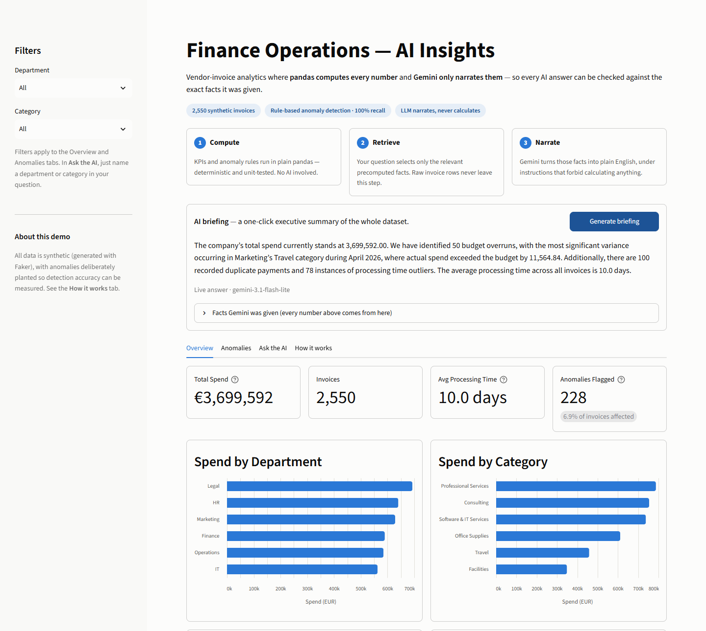
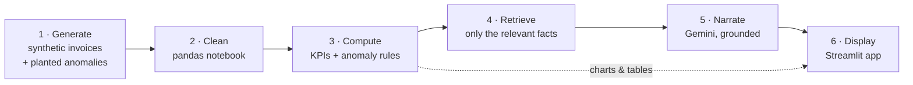
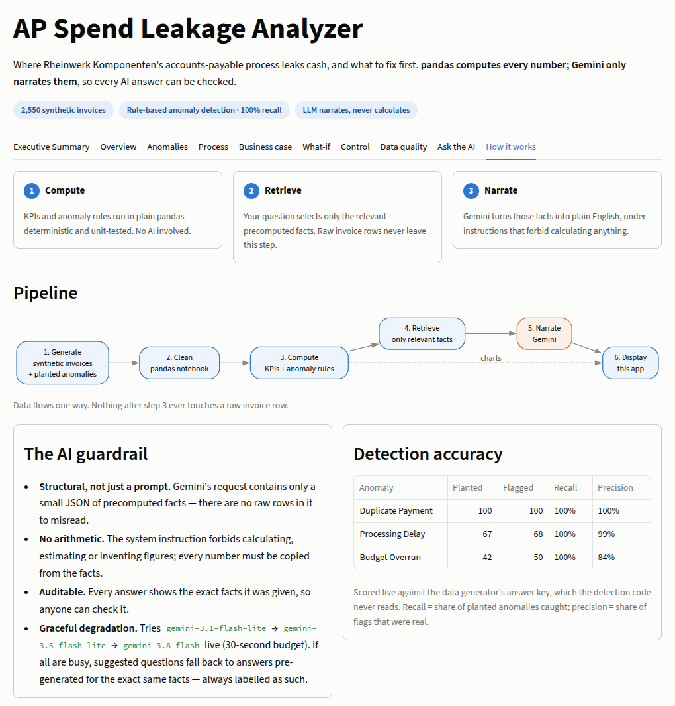
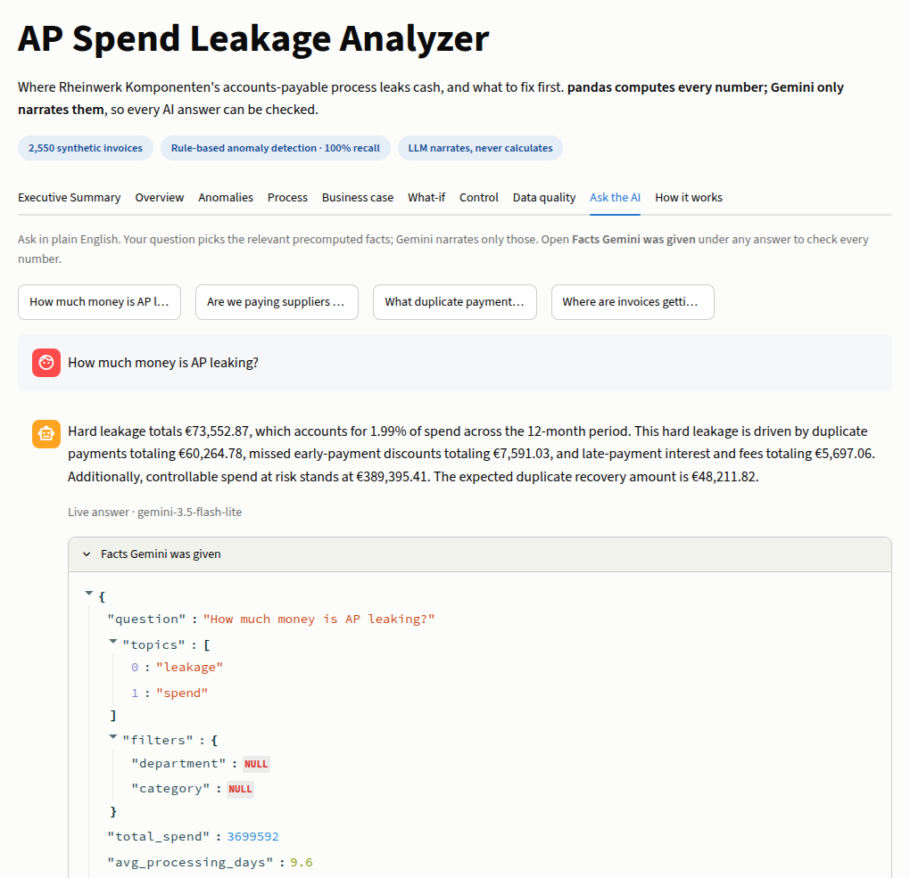
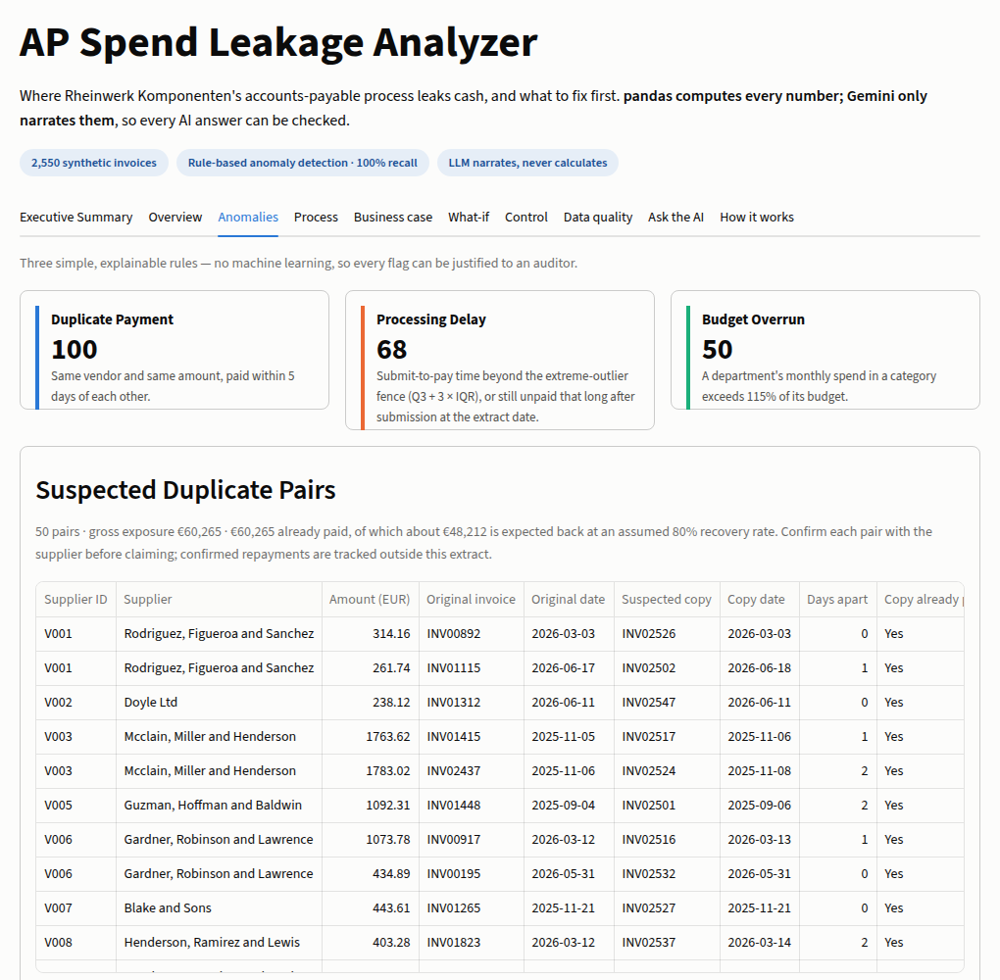

# AP Spend Leakage Analyzer

**Vendor-invoice analytics where pandas computes every number and an LLM only narrates them — so every AI answer can be checked against the exact facts it was given.**


[](LICENSE)



## In 30 seconds

- **The problem:** "AI finance dashboards" usually let the LLM read raw data and do the maths, so every answer is only as trustworthy as the model's arithmetic.
- **The approach:** deterministic pandas code computes the KPIs and flags anomalies; a retrieval step picks only the facts relevant to a question; Gemini turns those facts into plain English and is forbidden from calculating anything.
- **The evidence:** anomaly detection is scored live against a planted answer key — **100% recall on all three anomaly types** — and every AI answer ships with a "Facts Gemini was given" panel so anyone can audit it.
- **Built to keep working:** the free-tier LLM is often overloaded, so the app falls back across models and, as a last resort, to clearly labelled answers pre-generated for the exact same facts.

## Contents

- [Status and roadmap](#status-and-roadmap)
- [Architecture](#architecture)
- [Responsible AI: the guardrail is structural](#responsible-ai-the-guardrail-is-structural)
- [Example: ask a question](#example-ask-a-question)
- [Anomaly detection, and how well it works](#anomaly-detection-and-how-well-it-works)
- [Engineering highlights](#engineering-highlights)
- [Run it locally](#run-it-locally)
- [Project structure](#project-structure)
- [Honest limitations](#honest-limitations)
- [Tech stack](#tech-stack)
- [License](#license)

## Status and roadmap

The analytics baseline works today: the app with an answer-first Executive Summary, three detectors, € leakage by driver, AP KPIs, a SQL version of every KPI, a frozen Measure baseline, a data-quality view, process mining with root-cause analysis, a business case and 213 passing tests. It is being extended into a
**Lean Six Sigma DMAIC** engagement for a fictional client, an EU mid-size manufacturer. Each phase adds
business deliverables: € impact, process mining, a business case, and a control plan.

| Phase | Status | Deliverables |
|---|---|---|
| **Define** | Done | [Project charter](docs/01_project_charter.md) · [SIPOC](docs/02_sipoc.md) · [Issue tree and driver tree](docs/03_issue_and_driver_tree.md) · [Stakeholder map and RACI](docs/04_stakeholders_and_raci.md) · [Requirements](docs/05_requirements.md) · [As-is process model (BPMN)](docs/06_as_is_process.md) |
| **Data extension** | Done | Payment terms, purchase orders, process event log and a fixed extract date, checked against the answer key · [Data dictionary with SAP field mapping](docs/07_data_dictionary.md) |
| **Measure** | Done | € leakage by driver ([`src/impact.py`](src/impact.py)) and AP KPIs (DPO, on-time payment, discount capture, PO compliance, stage times, supplier Pareto), the Executive Summary tab with ranked recommendations, AI topics for leakage, payment timing, POs and supplier concentration, every KPI in SQL ([`sql/`](sql/README.md), DuckDB, checked against pandas), the [Measure baseline](docs/08_measure_baseline.md) (sigma levels, proposed targets, owners), and a Data quality tab (what each figure leaves out, failed checks, repairs to fix at the source) |
| **Analyze** | Done | [Root-cause analysis](docs/09_root_cause_analysis.md): process mining and conformance checking with pm4py ([`src/process_mining.py`](src/process_mining.py)), hard leakage by cause as a Pareto ([`src/root_cause.py`](src/root_cause.py)), an I-MR control chart of weekly processing time ([`src/control_chart.py`](src/control_chart.py)), fishbone and 5 Whys, a PO-reuse duplicate signal, and a Process tab in the app. Finding: two process gaps explain 90% of hard leakage |
| **Improve** | In progress | [Business case](docs/10_business_case.md) ([`src/business_case.py`](src/business_case.py)): €60k investment, €66k a year in hard benefits, 3-year NPV €119k, payback 8 months, with worst/base/best cases, a tornado chart and the break-even cost, on a Business case tab. Next: what-if scenarios, to-be process model, impact/effort matrix |
| **Control** | Planned | Control plan, Power BI / Tableau / Excel views |

## Architecture



Data flows one way: **raw → cleaned → computed facts → retrieved subset → narrated → displayed.** Nothing after stage 3 ever touches a raw invoice row.

| Stage | Code | What it does |
|---|---|---|
| 1 | [`data/generate_data.py`](data/generate_data.py) | Faker-based invoices with planted anomalies (duplicate payments, budget overruns, processing delays), supplier payment terms, purchase orders, a process event log (including reject-and-resubmit loops and approval breaches) and a fixed extract date, so recent invoices are still open. Realistic mess: inconsistent casing, mixed date formats, missing timestamps, payment terms and PO numbers typed several ways. Seeded and date-pinned, so it's fully reproducible. |
| 2 | [`notebooks/01_ingest_transform.ipynb`](notebooks/01_ingest_transform.ipynb) | Cleans and standardizes into `data/processed/`, with validation assertions before writing, and logs every kind of repair so it can be fixed at the source. Detects Databricks and switches to Unity Catalog storage automatically. |
| 3 | [`src/kpis.py`](src/kpis.py), [`src/anomalies.py`](src/anomalies.py), [`src/impact.py`](src/impact.py), [`src/process_mining.py`](src/process_mining.py), [`src/root_cause.py`](src/root_cause.py), [`src/control_chart.py`](src/control_chart.py) | Deterministic KPIs, three rule-based detectors, the € impact of each leakage driver, process mining and the cause behind each € of leakage — no LLM involved. |
| 4 | [`src/retrieval.py`](src/retrieval.py) | "RAG-lite": keyword/topic matching that selects which precomputed facts a question needs. No vector DB — the "documents" are a few structured tables, not prose. |
| 5 | [`src/insights.py`](src/insights.py), [`src/answers.py`](src/answers.py) | The only code that calls an LLM: a grounded prompt, a model fallback chain, and the pre-generated safety net. |
| 6 | [`app.py`](app.py), [`src/recommendations.py`](src/recommendations.py) | Streamlit app with eight tabs: **Executive Summary** (€ leakage and the top three fixes, with owners), **Overview**, **Anomalies** (with a CSV of suspected duplicate pairs for supplier claims), **Process** (leakage by cause, the discovered process map, variants, rework, control chart, and invoices paid outside the approved process with a CSV for Internal Audit), **Business case** (ROI, NPV, payback, scenarios and the tornado chart), **Data quality** (what each figure leaves out and why, failed checks with a CSV for AP, repairs to fix at the source), **Ask the AI**, **How it works**. |



## Responsible AI: the guardrail is structural

1. **The LLM never sees raw data.** `retrieval.py` returns aggregated KPIs and already-flagged anomaly records, narrowed to the question. There are no invoice rows in the request for the model to misread, and [`tests/test_retrieval.py`](tests/test_retrieval.py) checks the actual request body for every kind of question: no invoice-level fields (dates, amounts, PO numbers, statuses) and a bounded size.
2. **The LLM never calculates.** The system instruction ([`src/insights.py`](src/insights.py)) forbids arithmetic, estimation and invented figures: every number must be copied from the facts. It also forbids adding hard leakage and spend at risk into one total.
3. **Every answer is auditable.** The app shows the exact JSON the model received under each answer.
4. **Every answer is labelled with its source** — live (with the model name) or pre-generated (with model and date). A saved answer is keyed by a SHA-256 fingerprint of the facts it narrated, so it can never be shown for data it wasn't written about.

An LLM that narrates verified facts is far easier to trust, and to explain to a compliance or audit team, than one asked to compute figures on the fly.

<p align="center"></p>

## Example: ask a question

A real saved answer from the app (`data/pregenerated/answers.json`):

> **Q: Where are invoices getting delayed?**
>
> Based on the provided vendor invoice data, there are 78 processing time outlier anomalies identified across the organization, against an average processing time of 10.0 days. The records show specific delays spanning multiple departments, including IT, Marketing, Finance, Legal, Operations, and HR. Detailed examples include invoice INV00270 in Legal taking 82 days, invoice INV00236 in Marketing taking 81 days, and invoice INV00531 in Finance taking 88 days. All listed anomalies exceeded the established processing fence of 29.0 days.
>
> *Pre-generated · gemini-3.5-flash-lite · 2026-09-28*

Every figure in it comes from the facts JSON the model was given. The 78 outliers, the 10.0-day average and the 29-day fence are computed by `src/kpis.py` and `src/anomalies.py`, and the three invoice durations can be checked in the data.

*This answer was generated before the October 2026 data extension, which added an extract date: invoices not yet paid on 31 August 2026 are now open, so the current figures are 68 outliers and a 9.6-day average. The saved answers are regenerated in the final phase.*

## Anomaly detection, and how well it works

Three simple, explainable rules — deliberately not machine learning, so every flag can be justified:

| Anomaly | Rule | Planted | Flagged | Recall | Precision |
|---|---|---|---|---|---|
| Duplicate payment | Same vendor and amount, paid within 5 days | 100 | 100 | 100% | 100% |
| Processing delay | Submit-to-pay time above Q3 + 3 × IQR (Tukey's "extreme outlier" fence), or still open for longer than that at the extract date | 67 | 68 | 100% | 99% |
| Budget overrun | Monthly department/category spend above 115% of budget | 42 | 50 | 100% | 84% |

Scored against the generator's answer key ([`src/evaluation.py`](src/evaluation.py)), which the detection code itself never reads. The same scorecard is computed live in the app's **How it works** tab.

Two tuning decisions worth calling out:
- **3 × IQR, not the textbook 1.5 ×:** processing times are naturally long-tailed, and 1.5 × produced 35 false positives.
- **The 8 budget false positives are left in on purpose.** They are groups that drifted past 115% through ordinary variance. A fixed tolerance threshold is how real budget policy works, so these are genuine "worth a look" cases, not detector bugs.



## Engineering highlights

- **213 pytest tests:**
  - KPI sanity checks;
  - detection against the planted answer key;
  - the cleaned data against the answer key: maverick spend, missed discounts, late payments, approval breaches and rework loops, so a cleaning bug shows up as a test failure;
  - every SQL query against the pandas KPI it mirrors, so the app and the warehouse version can't disagree;
  - the frozen Measure baseline against a fresh calculation, so a data change can't move it silently;
  - process mining against the answer key: conformance finds exactly the planted approval breaches, and the cause Pareto adds up to the measured hard leakage;
  - the business case against a hand-worked NPV, ROI and payback example;
  - the LLM fallback chain, with the network faked so tests never call Gemini.
- **Graceful degradation:**
  - live models are tried in order, each with one attempt, under a 30-second budget;
  - a bad API key stops immediately instead of trying every model;
  - the pre-generated fallback is used only when every model fails.
- **Reproducible data:** a fixed seed and a pinned end date mean regenerating the data reproduces the included files byte for byte.
- **Cost-aware:** the landing-page briefing is shared across visitors for 24 hours, so it costs one LLM call per day, not one per visitor.

## Run it locally

**Linux / macOS**

```bash
cd ap-spend-leakage-analyzer
python3 -m venv .venv
source .venv/bin/activate
pip install -r requirements.txt

cp .env.example .env     # then add a free Gemini API key from aistudio.google.com
streamlit run app.py     # opens http://localhost:8501
```

**Windows (PowerShell)**

```powershell
cd ap-spend-leakage-analyzer
python -m venv .venv
.venv\Scripts\activate
pip install -r requirements.txt

copy .env.example .env   # then add a free Gemini API key from aistudio.google.com
streamlit run app.py     # opens http://localhost:8501
```

**Run the tests:** `pytest` (213 tests, about 14 seconds; no network or API key needed, because the Gemini calls are faked).

The cleaned data is included, so the app runs straight away. To rebuild the pipeline from scratch (same commands on every OS, with the venv active):

```bash
python data/generate_data.py                  # 1. regenerate raw CSVs (identical output)
pip install jupyter
jupyter nbconvert --to notebook --execute --inplace notebooks/01_ingest_transform.ipynb   # 2. clean
pytest                                        # 3. 213 tests
python scripts/pregenerate_answers.py         # 4. refresh fallback answers if the facts changed (needs a Gemini key)
```

## Project structure

```
├── app.py                          # Streamlit app (8 tabs)
├── src/
│   ├── kpis.py                     # deterministic KPIs: spend, payment timing, PO compliance, stage times
│   ├── anomalies.py                # three rule-based detectors
│   ├── impact.py                   # € leakage per driver, in two tiers
│   ├── process_mining.py           # pm4py: process map, variants, conformance
│   ├── root_cause.py               # each € of hard leakage traced to a process step
│   ├── control_chart.py            # I-MR chart of weekly processing time
│   ├── business_case.py            # ROI, NPV, payback, scenarios, tornado
│   ├── recommendations.py          # ranked fixes with owner, effort and € addressed
│   ├── baseline.py                 # Measure baseline: CTQs, sigma levels, targets, owners
│   ├── data_quality.py             # failed checks, what each figure leaves out, repairs to fix at source
│   ├── evaluation.py               # scores detectors against the answer key
│   ├── retrieval.py                # picks the facts a question needs
│   ├── insights.py                 # Gemini call: grounded prompt + model fallback chain
│   ├── answers.py                  # live-first answers, pre-generated fallback
│   └── sql_kpis.py                 # runs the SQL versions of the KPIs with DuckDB
├── sql/                            # one DuckDB query per KPI, straight on the parquet files
├── data/
│   ├── generate_data.py            # synthetic data + planted anomalies
│   ├── raw/                        # generated CSVs, event log, extract date + answer key
│   ├── processed/                  # cleaned parquet (notebook output)
│   ├── baseline/                   # frozen Measure baseline (CSV)
│   └── pregenerated/answers.json   # fallback answers, keyed by facts fingerprint
├── notebooks/01_ingest_transform.ipynb
├── scripts/                        # pregenerate_answers.py, draw_fishbone.py
├── tests/                          # test_kpis.py, test_impact.py, test_recommendations.py, test_retrieval.py, test_sql_parity.py, test_baseline.py, test_data_quality.py, test_process_mining.py, test_root_cause.py, test_control_chart.py, test_business_case.py, test_data_pipeline.py, test_insights.py
└── docs/                           # DMAIC deliverables (01–10), BPMN, diagrams, screenshots
```

## Honest limitations

- **Synthetic data.** Faker-generated invoices, vendors and budgets: realistic patterns, not real transactions.
- **Small anomaly set.** ~210 planted anomalies for the three detectors across 2,550 invoices — enough to validate detection logic, not to tune a production model.
- **Thresholds tuned on synthetic ground truth.** In a real deployment, the 115% overrun tolerance would be set with finance stakeholders, not fitted to a test set.
- **Keyword retrieval.** Right-sized for a few structured tables, but it won't understand every phrasing the way embedding search would.
- **Free-tier LLM.** Gemini's free tier is frequently overloaded. Typed questions may ask you to retry; the briefing and suggested questions fall back to pre-generated answers, always labelled as such.
- **Databricks.** The cleaning notebook is plain pandas (Spark isn't justified at ~2,500 rows) and is written to run on Databricks Free Edition. So far it has only been run locally.
- **No authentication, persistence or rate limiting** beyond what the Gemini free tier provides.

## Tech stack

Python 3.10+ · pandas · DuckDB (SQL) · pm4py (process mining) · Faker · Gemini API (plain REST, no SDK) · Streamlit + Altair · pytest. No paid cloud services.

## License

[MIT](LICENSE) © 2026 Prennoy Babu

The process-mining library [pm4py](https://pypi.org/project/pm4py/) is a dependency
under AGPL-3.0; it is installed from PyPI, not included in this repository.
