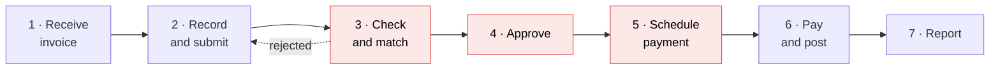

# SIPOC: invoice-to-pay at Rheinwerk HQ

> **Portfolio note.** Rheinwerk Komponenten GmbH is a fictional client and all data is synthetic.

A SIPOC is a one-page, high-level view of a process: who supplies it, what goes in, the main
steps, what comes out and who relies on the result. It fixes the boundaries before the detailed
process model (as-is BPMN, task 1.7) and before any measurement.

**Process:** invoice-to-pay for HQ indirect spend (scope as in the [project charter](01_project_charter.md)).
**Starts:** a supplier invoice arrives at HQ. **Ends:** the payment is made and posted, and the invoice is closed.

## The SIPOC

| Suppliers | Inputs | Process | Outputs | Customers |
|---|---|---|---|---|
| External suppliers (40 in scope) | Supplier invoices (PDF, paper, e-invoice) | **1. Receive invoice** | Invoice registered in the ERP | Suppliers: paid once, correctly, on time |
| Procurement | Purchase orders; supplier master data (bank details, payment terms) | **2. Record and submit** | Invoice submitted for approval | Budget owners: see spend before month-end |
| Budget owners (department heads) | Goods or service receipt confirmation | **3. Check and match** | Matched or rejected invoice | CFO and Controlling: accurate costs, no leakage |
| Controlling | Monthly budget by department and category | **4. Approve** | Approved invoice | Treasury: predictable cash out |
| Finance leadership | Approval limits (delegation of authority) | **5. Schedule payment** | Payment proposal | AP Manager: workload and backlog under control |
| IT (ERP) and the bank | ERP workflow; bank interface | **6. Pay and post** | Payment, cleared open item, remittance advice | External auditors: complete audit trail |
| | | **7. Report** | Budget-vs-actual report; AP ledger data | |

The rows are not paired: read each column on its own. The Process column is the sequence.

## Process steps in detail

*Red: the steps where most leakage happens (see the table below).*

| Step | What happens today | Where money leaks | Measured in our data by |
|---|---|---|---|
| 1. Receive invoice | Invoices arrive by e-mail, post or e-invoice. The AP inbox is checked daily. | Invoices waiting unopened, so discount windows close | `invoice_date` |
| 2. Record and submit | An AP clerk enters supplier, amount, dates and cost centre, then submits the invoice for approval. | Typing errors; a re-sent invoice is entered as new | `submitted_date` (missing for 24 invoices) |
| 3. Check and match | The clerk checks against the purchase order, where one exists. **No systematic duplicate check.** | **Duplicate payments**; spend without a purchase order (maverick spend) | No timestamp yet (Phase 2.3 adds reject/resubmit events) |
| 4. Approve | The budget owner approves in the ERP workflow, **without seeing the remaining budget**. | **Budget overruns** found only after month-end; slow approvals | `approved_date` |
| 5. Schedule payment | Weekly payment run picks up approved invoices. | **Missed early-payment discounts**; late-payment interest and fees | No timestamp yet (Phase 2 adds payment terms and due dates) |
| 6. Pay and post | Bank transfer; the payment is posted and the invoice is cleared. | Paying too early, which gives away cash | `paid_date` |
| 7. Report | Controlling produces budget vs actual after month-end close. | Problems surface too late to act on | Monthly aggregation of the above |

## What the customers need (critical to quality)

| Customer | Requirement | Measured by (CTQ in the charter) |
|---|---|---|
| Suppliers | Paid once, the right amount, by the due date | Duplicate payments; on-time payment rate |
| Budget owners | Know about an overrun before month-end, while it can still be stopped | Unapproved overruns |
| CFO and Controlling | No avoidable losses; costs booked to the right budget | € leakage by driver (Measure) |
| Treasury | Payments go out when planned, not early or late | Days payable outstanding (DPO) |
| AP Manager | Invoices move through without rework or long waits | Processing time (median and 90th percentile) |
| External auditors | Every payment approved, traceable and paid once | Missing timestamps; conformance check (Analyze) |

## What the SIPOC tells us

1. **Leakage concentrates in steps 3–5:** checking, approval and payment scheduling. That is where
   Measure and Analyze focus.
2. **Two steps have no timestamps.** Without them, delays inside checking and scheduling cannot be
   measured. The Phase 2 data extension adds rejection events, payment terms and due dates to fill that gap.
3. **The inputs that matter most belong to other teams.** Purchase orders and supplier terms come from Procurement,
   and budgets from Controlling. AP alone cannot fix leakage, so Procurement and Controlling are in the core team.
4. **E-invoicing is an opportunity.** Since January 2025, German companies must be able to receive
   structured e-invoices (XRechnung or ZUGFeRD). Structured data makes automated duplicate and
   purchase-order checks much easier, which is relevant to the to-be design in Improve.
