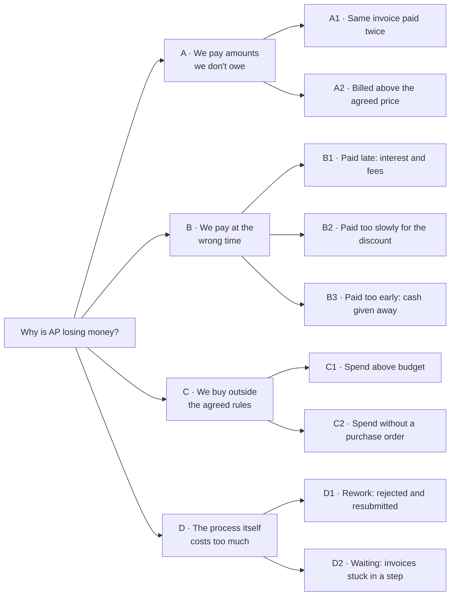
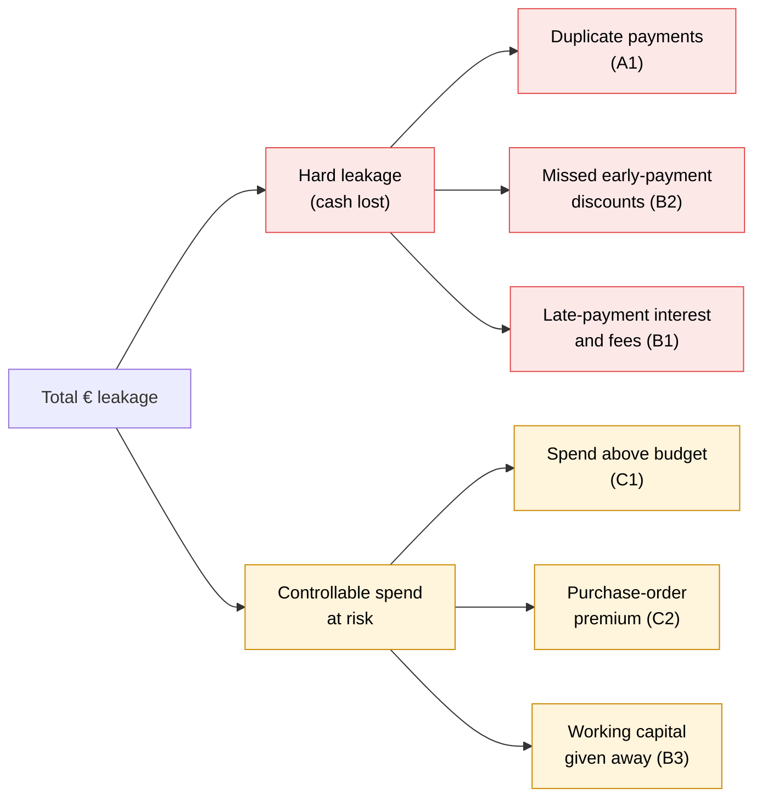

# Issue tree and driver tree: why and how much AP is leaking

> **Portfolio note.** Rheinwerk Komponenten GmbH is a fictional client and all data is synthetic.

Two trees, one question. The **issue tree** breaks *why* the invoice-to-pay process loses money into
testable hypotheses. The **driver tree** turns the same branches into *how much*: a formula for each €
driver that Measure (Phase 3) calculates from the data.

## 1. Issue tree

**Key question:** *Why is Rheinwerk losing money in invoice-to-pay for HQ indirect spend, and where?*

The first level splits losses by **what goes wrong**: the amount, the timing, the buying decision or the
process itself. Each loss belongs to exactly one branch (mutually exclusive), and together they cover every
way an AP process can lose money (collectively exhaustive). This structure is called MECE.

### Hypotheses and how each is tested

| # | Hypothesis | Test (analysis) | Data | Testable |
|---|---|---|---|---|
| A1 | Duplicates come from re-sent invoices entered as new, because step 3 has no duplicate check | Count and € of same-supplier, same-amount pairs ≤ 5 days apart; spread by supplier and month | Invoices | **Now** (detector exists) |
| A2 | Invoices without a purchase order are not checked against agreed prices | Compare invoice price with the PO or contract price | Line-level PO prices | **No**: the extract has no line items. Recommended as a follow-up. |
| B1 | Slow approvals push payments past the due date | On-time payment rate; days late vs approval duration | Due dates | **Now** |
| B2 | Approval takes longer than the 10-day discount window | Discount capture rate; capture by approval duration | Payment terms | **Now** |
| B3 | The payment run pays every approved invoice, whatever its terms | Days paid before the due date; DPO vs agreed terms | Due dates | **Now** |
| C1 | Approvers cannot see the remaining budget, so overruns are found after month-end | Overruns by department and category; whether they repeat month after month | Invoices, budgets | **Now** (detector exists) |
| C2 | Spend without a purchase order goes to non-preferred suppliers | PO compliance % by department; no-PO share with non-preferred suppliers | PO numbers, preferred flag | **Now** |
| D1 | A large share of invoices goes round a reject-and-resubmit loop | Process variants and their frequency; throughput time by variant | Process events | **Now** |
| D2 | Most of the waiting happens in approval | Time per stage (submit→approve, approve→pay); control chart by week | Invoices, process events | **Now** |

A2 is the one branch the data cannot test. It stays in the tree so the analysis is honest about what it does not cover.

**Verdicts after Analyze:** A1, B3 and D1 confirmed; B1, B2 and D2 partly. See the
[root-cause analysis](09_root_cause_analysis.md#8-hypotheses-verdicts).

## 2. Driver tree

**Total € leakage = hard leakage + controllable spend at risk**

The two tiers are kept apart on purpose:

- **Hard leakage** is cash lost or recoverable. It is the number the business case rests on.
- **Controllable spend at risk** is money spent against policy. Some of it is waste, but not all of it,
  so it is reported separately and never added to hard leakage without an explicit assumption.

### Driver formulas

| Driver | Formula | Assumptions to agree in Measure |
|---|---|---|
| **Duplicate payments** | Σ amount of the second invoice in each flagged pair | Recovery rate: share the suppliers actually repay (gross and confirmed reported separately) |
| **Missed discounts** | Σ over invoices with discount terms paid after the discount window: amount × discount % | None: terms and dates come from the data |
| **Late-payment cost** | Σ over invoices paid after the due date: amount × (base rate + 9 pp) × days late ÷ 365, plus €40 per late invoice | Base rate for the period. Many suppliers never claim, so this is **exposure**, not booked cost. |
| **Spend above budget** | Σ over department-category-months above 115% of budget: actual − budget | None. This is *controllable*, not lost: some overruns are justified. |
| **Purchase-order premium** | No-PO spend × assumed price premium | Premium %: agreed with Procurement, varied in the sensitivity analysis (Phase 5) |
| **Working capital** | Σ amount × days paid early × cost of capital ÷ 365 | Cost of capital (from the CFO) |

Late-payment cost uses the German rule for business-to-business payments (§ 288 BGB): interest at 9
percentage points above the base rate, plus a €40 flat fee per late invoice.

**Not monetised (yet):** rework and waiting (D1, D2) are measured as process metrics: rework rate and days per
stage. They only become € if the AP Manager agrees an hourly handling cost. This keeps the € figures to
those that can be defended.

### From driver to code

Every formula is one function in [`src/impact.py`](../src/impact.py), tested in
[`tests/test_impact.py`](../tests/test_impact.py) against the planted data and against hand-worked
examples. The figures feed the Executive Summary tab. In line with the project rule, Gemini only
describes these figures. It never calculates them.

### Assumptions used in Measure

These are named constants in `src/impact.py`. Phase 5 varies the uncertain ones in the sensitivity analysis.

| Assumption | Value | Source or owner |
|---|---|---|
| Duplicate recovery rate | 80% of paid duplicates credited back | Assumption; to confirm with the AP Manager |
| Base rate (§ 247 BGB) | 1.27% to 30 June 2026, 1.52% from 1 July 2026; the rate on the first day of default applies | Deutsche Bundesbank |
| Late-payment interest | Base rate + 9 pp, plus €40 per late invoice | § 288(2) and (5) BGB |
| Purchase-order premium | 5% of spend without a PO | Conservative assumption; to confirm with Procurement |
| Cost of capital | 8% a year | Typical WACC for a German mid-size manufacturer; to confirm with the CFO |

Two refinements to the formulas above:
- **Working capital** is measured to the discount date when the discount was taken (paying then still
  earns it), otherwise to the net due date.
- **Discounts, lateness and early payment** are judged on payment. The 93 invoices still open at the
  extract date have neither missed nor taken anything yet.

### First measured figures (12 months to 31 August 2026)

| Driver | Tier | Cases | € impact |
|---|---|---:|---:|
| Duplicate payments | Hard leakage | 50 pairs | 60,265 |
| Missed early-payment discounts | Hard leakage | 284 invoices | 7,591 |
| Late-payment interest and fees | Hard leakage | 123 invoices | 5,697 |
| **Hard leakage** | | | **73,553** (2.0% of spend) |
| Spend above budget | Spend at risk | 50 dept-category-months | 336,975 |
| Purchase-order premium | Spend at risk | 517 invoices | 39,889 |
| Working capital given away | Spend at risk | 2,261 invoices | 12,532 |
| **Controllable spend at risk** | | | **389,395** |

All 50 duplicate copies are already paid. At an 80% recovery rate, AP can expect about **€48k back** from
suppliers. Phase 3.6 records these figures, with the AP KPIs, as the official baseline.
