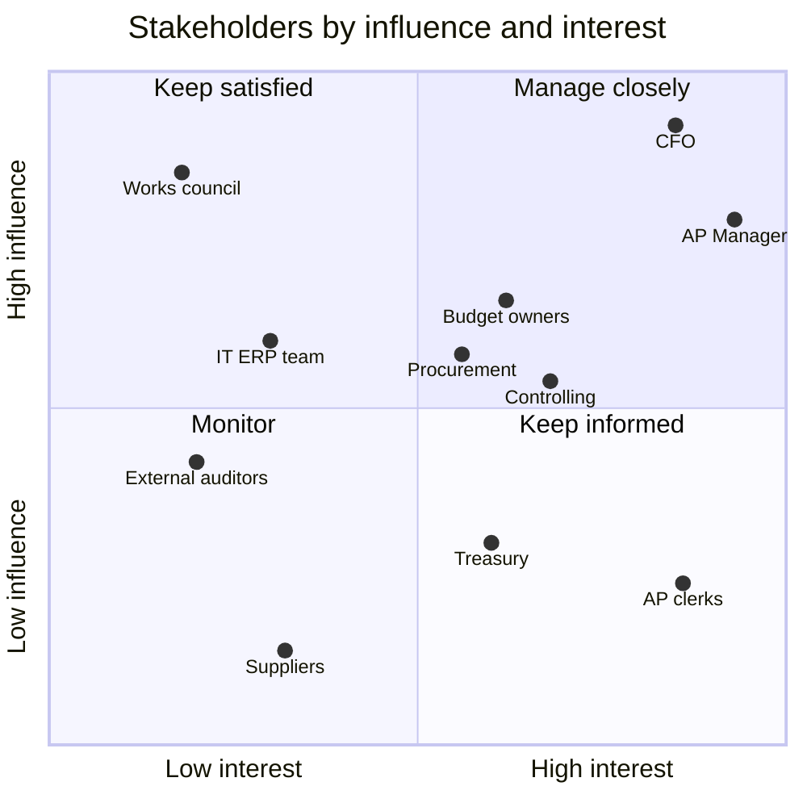

# Stakeholder map and RACI

> **Portfolio note.** Rheinwerk Komponenten GmbH is a fictional client and all data is synthetic.

This document shows who the project affects, how much influence each group has, and who does what.
It has two RACI matrices. The first covers the project's own work. The second covers the invoice-to-pay
process today. The second one shows that every leakage driver sits on a task that **no one is accountable for**.

Scope and roles as in the [project charter](01_project_charter.md) (section 8).

## 1. Stakeholder register

| Stakeholder | Role in invoice-to-pay | What they gain or fear | Influence | Interest |
|---|---|---|---|---|
| **CFO** | Sponsor; owns the AP automation investment decision | Gains: a hard € baseline for the decision. Fears: findings the auditors will read. | High | High |
| **AP Manager** | Process owner (Shared Finance Services) | Gains: fewer escalations, control of the backlog. Fears: findings read as a failure of their team. | High | High |
| **AP clerks** (×2) | Record, check and submit invoices; run the payment proposal | Gains: less rework and chasing. Fears: blame for duplicates; automation replacing their jobs. | Low | High |
| **Budget owners** (6 department heads) | Approve invoices for their cost centres | Gains: early warning before month-end. Fears: overrun reports read as blame; slower approvals. | Medium | Medium |
| **Procurement lead** | Owns purchase orders and supplier master data, including payment terms | Gains: evidence for PO compliance and preferred suppliers. Fears: being blamed for master-data errors. | Medium | Medium |
| **Controlling** | Sets monthly budgets; budget-vs-actual reporting | Gains: overruns caught while they can still be stopped. Fears: extra reporting work. | Medium | Medium |
| **IT (ERP team)** | Data extracts; any later workflow change | Gains: a clear, costed requirement instead of ad-hoc requests. Fears: unplanned work. | Medium | Low |
| **Works council** (Betriebsrat) | Co-determination on systems that can monitor employees | Wants: no person-level performance tracking without an agreement | High | Low |
| **Treasury** | Cash planning; executes the payment run | Gains: predictable cash out. Fears: payment dates moving without notice. | Low | Medium |
| **External auditors** | Raised the duplicate-payment finding | Want: duplicates resolved, every payment approved and traceable | Medium | Low |
| **Suppliers** (40 in scope) | Receive payments | Gain: paid on time. Fear: refund claims for duplicates; being paid on the due date rather than early. | Low | Low |

**Why the works council is on the list.** Under § 87(1) no. 6 of the German Works Constitution Act
(BetrVG), the works council must agree before the company introduces technical systems that *can* monitor
employees' behaviour or performance. A process-mining event log that records who approved what and when
falls under that rule. The project therefore keeps the analysis at **process and role level**: no names,
no user IDs. The invoice data has no person-level fields, and the process event log records only
the role (e.g. "AP clerk"), never the person. The works council is informed in Define, before any event
data is built.

## 2. Power–interest grid

| Quadrant | Stakeholders | Approach |
|---|---|---|
| **Manage closely** (high influence, high interest) | CFO, AP Manager, Budget owners, Procurement, Controlling | Core team or tollgate members; agree targets and assumptions with them, not for them |
| **Keep satisfied** (high influence, low interest) | Works council, IT (ERP team) | Short, early briefings; no surprises; involve before anything touches their remit |
| **Keep informed** (low influence, high interest) | AP clerks, Treasury | Clerks are in the core team: they know where the process really breaks. Treasury is told before payment timing changes. |
| **Monitor** (low influence, low interest) | External auditors, Suppliers | Auditors get the final control plan. Suppliers are contacted only for duplicate refunds. |

### Engagement: where each group is now and where it needs to be

| Stakeholder | Now | Needed by Improve | How to move them |
|---|---|---|---|
| CFO | Supportive | Leading | Tollgate at the end of each phase; one-page € summary, answer first |
| AP Manager | Neutral | Leading | Frame findings as *process* gaps, not team failures (see the process RACI below); they present the results at the final tollgate |
| AP clerks | Resistant | Supportive | Use their workarounds in the as-is model; position automation as removing manual checks, not jobs |
| Budget owners | Resistant | Supportive | Show overrun data as an early warning they receive *before* month-end, agreed with Controlling first |
| Procurement lead | Supportive | Supportive | Share maverick-spend (no PO) findings first; they support Procurement's own goals |
| Controlling | Neutral | Supportive | Reuse their budget file as-is; the monitoring view replaces part of their manual report |
| IT (ERP team) | Unaware | Supportive | One scoped data request in Define; costed requirements for Improve, so capacity can be planned |
| Works council | Unaware | Neutral (no objection) | Briefing in week 2: what data is used, that it is role-level only, and what is out of scope |
| Treasury | Unaware | Supportive | Involve in the payment-timing scenarios (discount capture vs due-date payment) |

## 3. Project RACI

**R** = Responsible (does the work) · **A** = Accountable (signs off; exactly one per row) ·
**C** = Consulted (two-way, before the decision) · **I** = Informed (one-way, after)

| Activity | CFO | AP Mgr | AP clerks | Budget owners | Procurement | Controlling | IT | Consultant |
|---|---|---|---|---|---|---|---|---|
| **Define** | | | | | | | | |
| Approve charter, scope and targets | **A** | C | I | I | C | C | I | R |
| Brief the works council on data use | **A** | C | I | | | | C | R |
| Provide the 12-month ERP extract | I | **A** | | | C | C | R | C |
| Map the as-is process (BPMN) | | **A** | C | C | C | | C | R |
| **Measure** | | | | | | | | |
| Validate data quality and baseline figures | I | **A** | C | | C | C | C | R |
| Agree detection thresholds (115% of budget, 5-day duplicate window) | I | **A** | C | C | | C | | R |
| Agree financial assumptions (cost of capital, PO premium, recovery rate) | **A** | C | | | C | C | | R |
| Confirm duplicate pairs and claim refunds from suppliers | I | **A** | R | | C | | | C |
| **Analyze** | | | | | | | | |
| Process mining and root-cause analysis | I | **A** | C | C | C | C | C | R |
| **Improve** | | | | | | | | |
| Design the to-be process | C | **A** | C | C | C | C | C | R |
| Build the business case (ROI, NPV, payback) | **A** | C | | | C | C | C | R |
| Decide on the AP automation investment | **A**/R | C | I | I | I | C | C | C |
| **Control** | | | | | | | | |
| Write the control plan | I | **A** | C | C | C | C | | R |
| Run the monthly leakage report after hand-over | I | **A** | R | I | I | C | | |
| Close tollgates | **A** | R | I | I | I | I | I | R |

Checks applied: every row has exactly one **A**; every row has at least one **R**; the consultant is never
**A**, so the client owns every decision; the consultant has no role in the last report row, because
after hand-over the AP Manager runs it without them (charter goal 4).

Treasury is **C** on the payment-timing scenarios inside "Design the to-be process". The external auditors
are **I** on the control plan.

## 4. Process RACI: invoice-to-pay today

The project RACI shows who does the project. This one shows who does the process, using the seven SIPOC steps
and the four control tasks that should stop leakage.

| Task | AP clerks | AP Mgr | Budget owners | Procurement | Controlling | Treasury | Leakage driver if missed |
|---|---|---|---|---|---|---|---|
| 1. Receive invoice | R | A | | | | | Discount window lost before entry |
| 2. Record and submit | R | A | | | | | Re-sent invoice entered as new |
| 3. Check and match against PO | R | A | | C | | | Spend without a PO |
| 4. Approve | | I | **A**/R | | | | Overrun approved blind |
| 5. Schedule payment | R | A | | | | C | Late or early payment |
| 6. Pay and post | | A | | | | R | |
| 7. Report budget vs actual | | I | I | | **A**/R | | Overrun found after month-end |
| **Control tasks** | | | | | | | |
| Check for duplicate invoices | *(ad hoc)* | — | | | | | **A1 Duplicate payments** |
| Check remaining budget before approving | | | *(cannot: no view)* | | — | | **C1 Spend above budget** |
| Time payments to take discounts and avoid late fees | *(run pays all)* | — | | | | — | **B1 / B2 / B3 Payment timing** |
| Keep payment terms in the supplier master correct | | — | | *(on creation only)* | | | **B2 Missed discounts** |

`—` = nobody in this role does it; *italics* = what happens today instead.

**What this shows.** The seven process steps all have an owner. The four tasks that would stop leakage have
**no Accountable owner**. Each one maps to a hypothesis in the [issue tree](03_issue_and_driver_tree.md):

| Ownership gap | Hypothesis it explains | Proposed owner (to confirm in Improve) |
|---|---|---|
| Duplicate check is ad hoc | A1: duplicates come from re-sent invoices entered as new | AP Manager accountable; automated check before payment, clerks clear the flags |
| Approvers cannot see remaining budget | C1: overruns are found only after month-end | Controlling accountable for the budget view; budget owners responsible for acting on it |
| Payment run pays every approved invoice | B1–B3: payment timing ignores terms | AP Manager accountable; payment run selects by due date and discount date; Treasury consulted |
| Payment terms set once, never reviewed | B2: discounts are missed | Procurement accountable; yearly review of supplier terms |

This is the main Define finding for the stakeholder conversation: leakage comes from **tasks no one owns**,
not from people doing their jobs badly. It also gives the AP Manager and the clerks a reason to support the
project rather than resist it. The proposed owners feed the to-be process model (task 5.3) and the control
plan (task 6.1).

## 5. Communication plan

| Audience | What | Format | When | Owner |
|---|---|---|---|---|
| CFO | Phase results, decisions needed | Tollgate review, 45 min, one-page summary | End of each phase (weeks 2, 5, 8, 10, 12) | Consultant, with the AP Manager presenting from Improve on |
| Core team (AP Mgr, clerks, Procurement, Controlling) | Progress, data questions, next steps | Stand-up, 30 min | Weekly (fits the ~2 h/week limit) | Consultant |
| Budget owners | Overrun findings for their department; early-warning design | Workshop, 60 min | Week 4 (Measure) and week 9 (Improve) | AP Manager and Controlling |
| Works council | Data used, role-level only, no performance monitoring | Briefing and short written summary | Week 2 (Define), and again if the scope changes | CFO |
| IT (ERP team) | Data extract request; later, costed to-be requirements | Ticket and one meeting | Week 1; week 10 | Consultant |
| Treasury | Payment-timing scenarios | Meeting, 30 min | Week 9 (Improve) | AP Manager |
| Suppliers (affected only) | Confirmation and refund request for duplicate payments | Letter or e-mail from AP | From week 4, as pairs are confirmed | AP clerks |
| External auditors | Control plan and status of duplicate recovery | Document | Week 12 | AP Manager |
