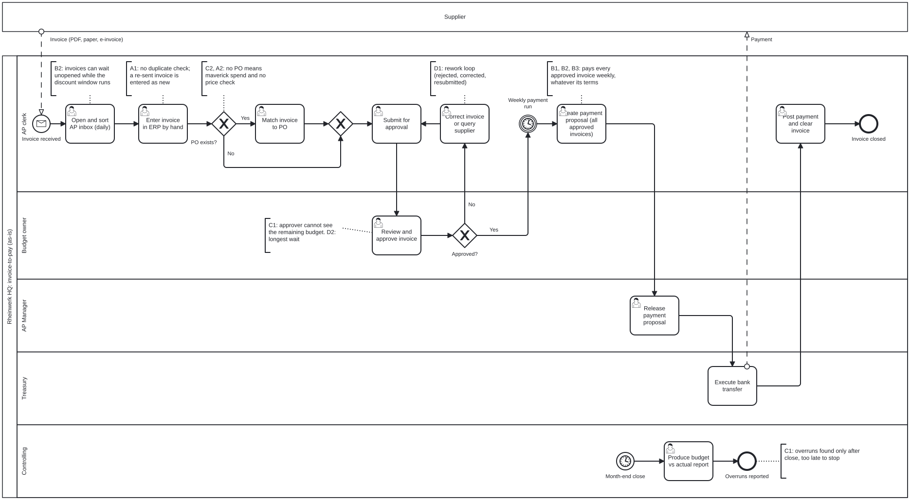
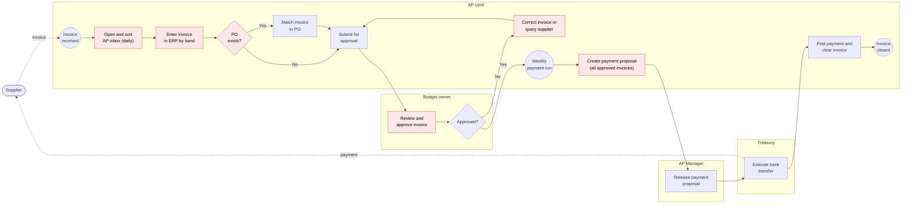

# As-is process model: invoice-to-pay at Rheinwerk HQ

> **Portfolio note.** Rheinwerk Komponenten GmbH is a fictional client and all data is synthetic.

This is the invoice-to-pay process **as the people who run it describe it**, modelled in BPMN 2.0. It is
more detailed than the [SIPOC](02_sipoc.md). It shows who does each step, where invoices wait and where
money leaks. In Analyze (task 4.1), process mining compares this model with the process **as it actually
runs** in the data. The differences between the two are findings in themselves.

**Source file:** [`bpmn/as_is_invoice_to_pay.bpmn`](bpmn/as_is_invoice_to_pay.bpmn) (BPMN 2.0 XML). Open it in
[Camunda Modeler](https://camunda.com/download/modeler/) or in the browser at [demo.bpmn.io](https://demo.bpmn.io)
(drag the file onto the page).

## The model

*Exported from the BPMN file. Below, a simplified version of the same flow, coloured by leakage point.*

*Red: a leakage point (see the table below). The simplified version leaves out Controlling's separate
month-end flow (month-end close → budget vs actual report → overruns reported), which the BPMN model shows.*

## Steps, timestamps and leakage points

| # | Step | Lane | Timestamp in the data | Leakage point | Hypothesis |
|---|---|---|---|---|---|
| 1 | Invoice received (message from the supplier) | AP clerk | `invoice_date` | | |
| 2 | Open and sort AP inbox, daily | AP clerk | | Invoices wait unopened while the discount window runs | B2 |
| 3 | Enter invoice in ERP by hand | AP clerk | | **No duplicate check**: a re-sent invoice is entered as new | A1 |
| 4 | PO exists? Yes → match invoice to PO. No → skip | AP clerk | | No PO: maverick spend, and no check against an agreed price | C2, A2 |
| 5 | Submit for approval | AP clerk | `submitted_date` (missing for 24 invoices) | | |
| 6 | Review and approve | Budget owner | `approved_date` | Approver **cannot see the remaining budget**; the longest wait | C1, D2 |
| 7 | Not approved → correct invoice or query supplier → resubmit | AP clerk | `invoice_events`: Reject invoice, Correct and resubmit | Rework loop | D1 |
| 8 | Wait for the weekly payment run | (timer) | | | |
| 9 | Create payment proposal: **every approved invoice**, whatever its terms | AP clerk | | Paid late (fees), too late for the discount, or too early | B1, B2, B3 |
| 10 | Release payment proposal | AP Manager | | | |
| 11 | Execute bank transfer (message to the supplier) | Treasury | `paid_date` | | |
| 12 | Post payment and clear invoice | AP clerk | | | |
| — | Month-end close → budget vs actual report | Controlling | (monthly) | Overruns found only after close, too late to stop | C1 |

## Where the time goes

Elapsed days between the timestamps, all 12 months (preliminary, from the current extract):

| Stage | Steps | Median | Mean | 90th percentile | Max |
|---|---|---|---|---|---|
| Receive → submit | 1–5 | 3 | 2.5 | 5 | 5 |
| **Submit → approve** | 5–7 | **4** | **5.3** | **10** | 40 |
| Approve → pay | 8–11 | 3 | 4.4 | 8 | 66 |
| **Invoice → pay (total)** | 1–11 | 10 | 12.1 | 18 | 95 |

Each stage counts only invoices that have both dates: invoices still open at the 31 August extract, the 24
with no submission date and the 13 paid before or without approval are left out of the stages they distort.

- **Approval is the longest stage.** It takes 44% of the average time from invoice to payment, and it has the
  widest spread. This supports hypothesis D2 and is where Analyze looks first.
- **Approve → pay has a median of 3 days**, which fits a weekly payment run (an average wait of 3.5 days).
  The run adds waiting time to every invoice, and it pays without looking at due or discount dates.
- **Rework doubles approval time.** 15% of invoices are rejected and resubmitted at least once. Their
  approval takes a median of 7 days, against 3 days for invoices approved first time. The most common
  rejection reason is a wrong cost centre, then an amount that differs from the PO. The event log
  (`invoice_events`) records each loop; the invoice table keeps only the final dates.

## What the model tells us

1. **Leakage happens at hand-offs and checks no one owns.** Steps 3, 6 and 9 are where the four control
   tasks without an Accountable owner (see the [process RACI](04_stakeholders_and_raci.md#4-process-raci-invoice-to-pay-today))
   should happen.
2. **The payment run ignores payment terms.** One rule for all invoices means some are paid too late, some
   miss the discount and some are paid too early. This one step drives all three timing hypotheses (B1–B3).
3. **Budget information arrives after the decision.** The approver decides in step 6. Controlling reports on
   budgets only after month-end close. The to-be process needs the remaining budget visible at the point
   of approval.
4. **The duplicate check leaves no trace in the data, because it does not exist.** What the process does not
   record cannot be monitored. The rework loop had the same problem until the event log was added to the
   extract. Both belong in the control plan.

## Modelling conventions

- BPMN 2.0, with one pool for Rheinwerk HQ and one collapsed pool for the supplier. Message flows show
  the invoice and the payment.
- **Lanes are roles, never named people**, in line with the works-council decision in the
  [stakeholder map](04_stakeholders_and_raci.md).
- Text annotations mark each leakage point with its issue-tree hypothesis ID.
- User tasks are done by a person in the ERP. "Execute bank transfer" is a plain task: Treasury sends the
  payment file and the bank interface does the rest.
- The as-is model shows what people *say* happens. It is validated against the event log in Analyze (4.1,
  4.2): a discovered process map, its variants, and a conformance check (paid without approval, paid before approval).
  Results: [root-cause analysis](09_root_cause_analysis.md). The log confirms the main flow and the rework loop, and adds
  three kinds of path this model doesn't show: paid before approval, paid without approval, and no submission recorded.
