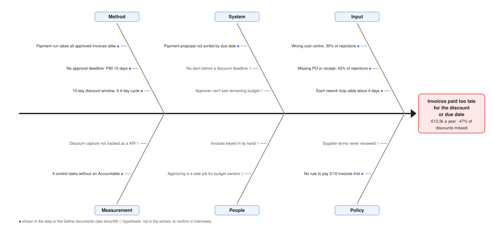

# Analyze: why AP leaks cash and where the time goes

> **Portfolio note.** Rheinwerk Komponenten GmbH is a fictional client and all data is synthetic.

Measure put a number on the leakage ([baseline](08_measure_baseline.md)). Analyze finds which step in the
process causes it, so each fix goes to the right owner. Every figure here is computed by the code named in
[How this was done](#how-this-was-done) and covers the 12 months to 31 August 2026.

## The answer first

1. **Two process gaps explain 90% of hard leakage.** There is no duplicate check when an invoice is keyed
   in (€60.3k, 82%), and the payment run pays every approved invoice on the same cycle, whatever its terms
   (€6.3k, 9%). Approval delays explain the remaining €7.0k.
2. **A PO check at entry would have blocked 46 of the 50 duplicates (€57.7k) before payment.** Every
   re-sent invoice that had a PO reused it. The ERP can check this exactly, at entry, with no false alarms.
3. **The process is stable but slow, and slow by design.** Weekly processing time stays inside its control
   limits apart from one explained week. Speed comes from changing the process, not from chasing bad weeks.
   80% of invoices go straight through in a median 9.4 days; each rework loop adds about 4 days.
4. **98.5% of paid invoices follow the approved process.** The 13 that were paid before or without an
   approval (€19.8k) are control breaches for Internal Audit, not leakage.

## 1. How the process actually runs (task 4.1)

Process mining with pm4py on the event log (10,882 events, 2,550 invoices, role level only). The
[as-is model](06_as_is_process.md) is how the team describes the process; this is what the log shows.

| Path type | Invoices | Share | Median days, receipt to payment | 90th percentile |
|---|---|---|---|---|
| Straight through (receive, submit, approve, pay) | 2,050 | 80.4% | 9.4 | 16.3 |
| Rework (one or more reject-and-correct loops) | 371 | 14.5% | 14.3 | 27.3 |
| Submission not recorded (data gap) | 23 | 0.9% | 9.3 | 14.3 |
| Control breach (paid before or without approval) | 13 | 0.5% | 13.3 | 18.9 |
| Open at the extract date | 93 | 3.6% | | |

**What rework costs.** A median of 9.4 days with no rework, 13.3 days with one loop (314 invoices), and
18.3 days with two (57 invoices, 90th percentile 55 days). The loop is the reason the slow tail is long.

**No single bottleneck.** The directly-follows graph shows similar waits at each hand-off: receive → submit
3.0 days, submit → approve 3.2, approve → pay 3.1 (medians). Approval is the longest stage measured on the
invoice dates (median 4 days of 7), and no department stands out (all 3–4 days). Time is lost across
hand-offs, not in one queue, so a single fix such as "approve faster" will not halve the cycle.

**Sixteen variants, with three kinds of path the as-is model doesn't show.** The log contains invoices paid before
the approval was recorded (8), paid with no approval (5), and approved with no submission recorded (24, of
which 23 are only a data gap). The first two are discussed under conformance below.

## 2. Conformance: paid outside the approved process (task 4.2)

The approved process (receive, submit, any number of reject-and-correct loops, approve, pay) was written
as a process tree and every paid invoice was aligned against it with pm4py. An alignment shows exactly which
step was skipped or out of order. Open invoices are not checked: they haven't finished yet.

| Deviation | Invoices | Amount | What the alignment found | Who acts |
|---|---|---|---|---|
| Paid before approval | 8 | €12,516 | Pay invoice out of order (approval recorded 1–7 days after payment) | Internal Audit, AP Manager |
| Paid without approval | 5 | €7,262 | Approve invoice missing | Internal Audit, AP Manager |
| Submission not recorded | 23 | €21,101 | Submit for approval missing | IT (entry screen); see the app's Data quality tab |

2,421 of 2,457 paid invoices (98.5%) conform. The 13 breaches match the 13 planted in the test data
exactly (tested). The deviation list is downloadable on the app's Process tab.

## 3. Where the money is lost: Pareto by cause (task 4.3)

Each euro of hard leakage is attributed to the step that let it happen, by a rule on the invoice's own
dates (`src/root_cause.py`):

- A **duplicate payment** got through entry: there is no duplicate check.
- A **missed discount or late payment** where the approval left less than a day to pay, and the payment
  waited for it, was lost in **approval**. It is split into approvals slowed by rework and slow approvals
  without rework. One day is the shortest approve-to-pay time in the data.
- Otherwise the invoice was approved in time and the **payment run** paid it too late.

| # | Cause | Process step | Hypothesis | Invoices | € a year | Cumulative |
|---|---|---|---|---|---|---|
| 1 | No duplicate check at invoice entry | Enter invoice in ERP | A1 | 50 | €60,265 | 81.9% |
| 2 | Payment run ignores discount and due dates | Create payment proposal | B3 | 192 | €6,278 | 90.5% |
| 3 | Slow approval, no rework | Review and approve | B1, B2 | 136 | €4,018 | 95.9% |
| 4 | Rework delays approval past the deadline | Correct and resubmit | D1 | 75 | €2,991 | 100.0% |
| | **Total hard leakage** | | | | **€73,553** | |

The total equals the hard leakage measured in Measure (tested). Of the €13.3k lost to timing,
47% is lost **after** a timely approval. Approve-to-pay takes a median of 3 days whether a 2% discount is
at stake or not, so a payment run that picks discount invoices first is the cheapest fix there is.

Spend at risk (€389k) is not attributed: it is not lost cash (see the two tiers in the
[driver tree](03_issue_and_driver_tree.md#2-driver-tree)).

## 4. Is the process stable? Control chart (task 4.4)

An individuals and moving-range (I-MR) chart of the weekly mean submit-to-pay days, one point per payment
week (49 full weeks; the first 21 days are left out because early payment weeks can only contain fast
invoices). Limits follow the usual Phase I practice: computed, the week outside them set aside, and
computed again.

| | Value |
|---|---|
| Centre line | 9.57 days |
| Control limits (individuals) | 6.03 to 13.10 days |
| Upper limit of the moving range | 4.34 days |
| Signals | 1 week outside the limits (27 April 2026, 16.1 days); no run of 8 weeks on one side |

**The signal is explained.** The five slowest invoices paid that week took 59–89 days, and all five are
flagged by the processing-delay rule on the Anomalies tab. Without them the week is normal.

**What the chart means for the client.** Every other week is common-cause variation. Discussing a "bad week"
of 11 or 12 days is wasted effort: that is how this process behaves. To pay faster and capture discounts,
the process itself has to change (Improve), and the same limits will then show whether it did (Control).

## 5. Fishbone: why invoices are paid too late (task 4.5)

The main delay problem is invoices paid after the discount or due date: €13.3k a year, and 47% of the
discounts on offer are missed (284 of 609 paid invoices with 2/10 Net 30 terms).

*● shown in the data or the Define documents; ○ a hypothesis the extract can't test, to confirm in
interviews with the AP clerks and budget owners. Source: [`scripts/draw_fishbone.py`](../scripts/draw_fishbone.py).*

The data-backed causes, with the evidence:

| Cause | Evidence |
|---|---|
| Payment run takes all approved invoices alike | Approve → pay median 3 days for discount and non-discount invoices alike |
| No approval deadline | Submit → approve median 4 days, 90th percentile 10 days: the whole discount window |
| 10-day window, 9.4-day cycle | Straight-through median receipt to payment is 9.4 days; any delay misses the discount |
| Approval timing decides capture | Approved with 6–10 days left: 5% missed. With 3–5 days left: 28%. With 1–2 days left: 68%. On or after the deadline: all 154 missed |
| Rework | 14.5% of invoices; each loop adds about 4 days; 55% of rejections (wrong cost centre, missing PO) could be stopped at entry |
| Nobody accountable | The [process RACI](04_stakeholders_and_raci.md) shows no Accountable owner for timing payments to terms |

## 6. Five whys

**Duplicate payments (82% of hard leakage)**

1. *Why did we pay €60.3k twice?* 50 invoices that suppliers sent again were paid as new invoices.
2. *Why were they paid as new?* They were keyed in as new documents, and nothing compared them with invoices
   already in the system.
3. *Why did nothing compare them?* Invoice entry has no duplicate check; checks happen ad hoc, if at all.
4. *Why is there no check?* The ERP's duplicate warning only fires on an identical supplier reference, which
   a re-sent PDF often doesn't repeat (hypothesis, to confirm with IT), and the PO is not checked
   against invoices already received.
5. *Why is the PO not checked?* No one owns the duplicate control (process RACI: ad hoc, no Accountable).

**Root cause:** no control at entry and no owner. **Fix direction:** block an invoice on a PO that is
already invoiced (stops 46 of 50, €57.7k), plus the supplier-and-amount rule as a review list for the rest.

**Paid too late for the discount**

1. *Why do we miss 47% of discounts?* 284 invoices with 2/10 terms were paid after day 10.
2. *Why after day 10?* 130 were approved in time but paid late; 154 were approved too late to pay in time.
3. *Why were the 130 paid late although approved in time?* The payment run takes approved invoices in one
   cycle, about 3 days after approval, without looking at the discount date.
4. *Why are the 154 approved so late?* Entry and approval take about 7 of the 10 days on a typical invoice
   (median 3 days to submit, 4 to approve); there is no approval deadline, and each rework loop adds about 4 days.
5. *Why is no one steering this?* Discount capture has no owner and is not reported, so nobody sees the €
   being lost (process RACI; charter CTQ baseline).

**Root cause:** the process is built for volume, not for payment terms, and timing has no owner.
**Fix direction:** pay by discount and due date, an approval deadline for discount invoices, and fewer
rejections through validation at entry.

## 7. A second duplicate signal: purchase-order reuse (task 4.8)

`anomalies.find_po_reuse` flags an invoice booked on a PO that already has an invoice. In this extract each
PO covers one delivery, so a second invoice on it is a re-sent invoice.

| Rule | Finds | Precision | Recall | When it can act |
|---|---|---|---|---|
| Same supplier and amount within 5 days (detector in the app) | 50 of 50 | 100% | 100% | After entry, as a review list |
| Invoice on a PO already invoiced | 46 of 50 | 100% | 92% | **At entry, as a block** |

The four the PO rule misses had no PO. The PO rule finds nothing the existing rule doesn't, so it is not
added to the app's detectors (that would also change the saved AI answers for no gain). Its value is
*when* it acts: it can stop €57.7k before payment instead of recovering it afterwards. It is the
duplicate part of the three-way match in the to-be process (task 5.3). With partial deliveries the rule
would become "invoiced total above the PO value", which needs PO values this extract doesn't have.

## 8. Hypotheses: verdicts

| ID | Hypothesis ([issue tree](03_issue_and_driver_tree.md#hypotheses-and-how-each-is-tested)) | Verdict | Evidence |
|---|---|---|---|
| A1 | Duplicates come from re-sent invoices with no duplicate check | **Confirmed** | 50 pairs, €60.3k; 46 reuse a PO number |
| A2 | No-PO invoices aren't checked against agreed prices | Not testable | No line-level prices in the extract |
| B1 | Slow approvals push payments past the due date | **Partly** | Explains 61 of 123 late payments (€2.9k of €5.7k); the other 62 were approved in time |
| B2 | Approval takes longer than the discount window | **Partly** | Explains 154 of 284 missed discounts (€4.1k of €7.6k) |
| B3 | The payment run pays every approved invoice, whatever its terms | **Confirmed** | Same approve-to-pay time with or without a discount; €6.3k hard leakage, plus €12.5k working capital (Measure) |
| C1 | Approvers can't see remaining budget | Measured, not re-tested | Repeat overruns in [Measure](08_measure_baseline.md); fixed by the budget view in Improve |
| C2 | No-PO spend goes to non-preferred suppliers | Measured, not re-tested | €699k of €798k no-PO spend is with non-preferred suppliers (Measure) |
| D1 | Many invoices go round a reject-and-resubmit loop | **Confirmed** | 14.5% of invoices; about 4 days per loop; 55% of rejections preventable at entry |
| D2 | Most of the waiting is in approval | **Partly** | Approval is the longest stage (median 4 of 7 days), but waits are similar at every hand-off |

## 9. What this means for Improve

| Root cause | Improvement to design in Phase 5 | Owner (process RACI) |
|---|---|---|
| No duplicate check at entry | Block invoices on an already-invoiced PO; supplier-and-amount review list | AP Manager, IT |
| Payment run ignores terms | Payment proposal selected by discount and due date | AP Manager, Treasury consulted |
| Slow approval | Approval deadline for discount invoices; reminder before the deadline | Budget owners, AP Manager |
| Rework | Validation of cost centre and PO at entry | IT, AP clerks |
| Paid before or without approval | Payment block without an approval in the ERP | AP Manager, Internal Audit |

The business case (task 5.2) prices these fixes; the what-if tab (task 5.1) shows how much each lever moves.

## How this was done

| Analysis | Code | Tests |
|---|---|---|
| Event log, process map, variants, throughput, conformance | `src/process_mining.py` (pm4py) | `tests/test_process_mining.py` |
| Leakage by cause (Pareto) | `src/root_cause.py` | `tests/test_root_cause.py` |
| I-MR control chart | `src/control_chart.py` | `tests/test_control_chart.py` |
| PO reuse signal | `src/anomalies.py` (`find_po_reuse`) | `tests/test_kpis.py` |
| SQL versions of variants and approval breaches | `sql/process_variants.sql`, `sql/approval_breaches.sql` | `tests/test_sql_parity.py` |

The planted test data checks the analysis: conformance finds exactly the planted approval breaches, the
rework paths are exactly the planted rework loops, and the Pareto adds up to the measured hard leakage.
