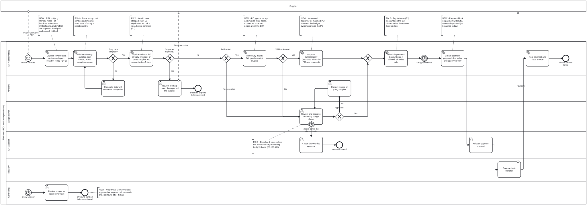

# To-be process model: invoice-to-pay after the fixes

> **Portfolio note.** Rheinwerk Komponenten GmbH is a fictional client and all data is synthetic.

This is the invoice-to-pay process **with the fixes from the [business case](10_business_case.md)
in place**, modelled in BPMN 2.0 like the [as-is model](06_as_is_process.md). It shows where each fix sits,
who owns each step, and which checks the ERP does instead of a person. The ERP changes are designed and
costed, not built (charter scope).

**Source file:** [`bpmn/to_be_invoice_to_pay.bpmn`](bpmn/to_be_invoice_to_pay.bpmn) (BPMN 2.0 XML), generated
by [`scripts/build_to_be_bpmn.py`](../scripts/build_to_be_bpmn.py). Open it in
[Camunda Modeler](https://camunda.com/download/modeler/) or at [demo.bpmn.io](https://demo.bpmn.io).

## The model

*Annotations: **FIX n** is the fix number in the business case, **NEW** is a change with no € counted.*

## What changes, and why

| As-is step | To-be | Fix | € a year (business case) | Hypothesis | Owner |
|---|---|---|---|---|---|
| Open and sort AP inbox; enter invoice by hand | E-invoices imported; an RPA bot reads PDF invoices into the ERP | New (not costed) | Not counted | | IT |
| Enter invoice; PO exists? | Validation at entry: supplier, cost centre against the department, PO number or an exception reason | 4 | €1,650 | D1 | IT, AP clerks |
| (no duplicate check) | **Duplicate check before anything else happens**: block an invoice on a PO that is already invoiced; same supplier and amount within 5 days goes to the AP clerk | 1 | €57,731 | A1 | AP Manager, IT |
| Match invoice to PO (by hand) | Three-way match: PO, goods receipt and invoice must agree within tolerance | New | Not counted | A2 | Procurement, IT |
| Every invoice goes to a budget owner | **Matched PO invoices are approved automatically**: the budget owner approved the spend when the PO was released. Only exceptions and mismatches go to a person | New | Not counted | D2 | Budget owners |
| Review and approve (no deadline, no budget view) | Approval with the remaining budget shown, and a deadline two days before the discount date; the AP Manager chases overdue approvals | 3 | €2,009 | B1, B2, C1 | Budget owners, AP Manager |
| Weekly run pays every approved invoice | **Each invoice is scheduled by its terms** (last discount day if a discount is offered, else the due date); a daily run pays what is due | 2 | €5,023 hard, plus €10,025 working capital (estimated) | B3 | AP Manager, Treasury consulted |
| Payment proposal | Payment block: nothing is paid without a recorded approval | New (control) | Not counted | | AP Manager, Internal Audit |
| Month-end budget vs actual report | Weekly review of a live budget view; overruns approved or stopped before month-end | New | Spend to review, not a saving | C1 | Controlling |

## What it does to the process

| Measure | As-is (baseline) | To-be, expected | Source |
|---|---|---|---|
| Duplicates paid | 50 a year, €60.3k | 4 a year at most, the ones without a PO; those are caught on the review list | Fix 1 (46 of 50 reuse a PO) |
| Invoices waiting for a budget owner | All 2,550 | About 27%: exceptions and mismatches. About 73% are PO invoices with no price or goods-receipt rejection, which would match | Event log: 2,033 PO invoices, 181 of them rejected for a price or receipt mismatch |
| Rejections | 446 a year; 15.2% of invoices sent back at least once | Up to 55% fewer: wrong cost centre and missing PO are stopped at entry | Reject reasons |
| Discount capture | 53.4% | About 83% at the business case's base assumptions; 90% needs fixes 2 and 3 near their best case | 130 of the 284 missed discounts are lost after a timely approval (fix 2), 154 in approval (fix 3) |
| Paid before or without approval | 13 | 0 | Payment block |
| Hand-offs per straight-through invoice | 4 people (clerk, budget owner, AP Manager, Treasury) | 2 (AP Manager releases, Treasury pays) | Model |

Automatic approval of matched PO invoices is the biggest change to how the process feels, but the
business case counts none of it: it has no € figure the data can prove. It is the main reason the
processing-time goal (median from 7 to 4 days) is realistic, and the main route to the 90% discount-capture
target: at the base assumptions (80% of payment-run misses and 50% of late approvals avoided) capture reaches
about 83%. It takes about 75% of late approvals avoided to pass 90%, which only works if most invoices no
longer wait for a person. The target stays at 90%; the control plan (Phase 6) tracks whether it is met.

## Ownership: the gaps from Define are closed

The [process RACI](04_stakeholders_and_raci.md) found four control tasks with no Accountable owner.
In the to-be model each one is a step with an owner:

| Gap in the as-is process | To-be step | Accountable |
|---|---|---|
| Duplicate check is ad hoc | Duplicate check at entry, flags cleared daily | AP Manager |
| Approvers can't see the remaining budget | Remaining budget shown at approval; weekly budget review | Controlling |
| Payment run pays every approved invoice | Payment scheduled by terms | AP Manager |
| Payment terms set once, never reviewed | Yearly review of supplier terms (outside this model: Procurement's supplier-master process) | Procurement lead |

## The RPA step: designed, not built

**What the bot does.** It reads PDF invoices from the AP mailbox, extracts supplier, invoice number, date,
amount and PO number, and creates the invoice in the ERP for the validation step. Invoices it can't read
with confidence go to the AP clerk. E-invoices in a structured format (XRechnung, ZUGFeRD) are imported
directly and need no bot. German law already requires businesses to be able to receive e-invoices, and their
share will grow as the obligation to send them is phased in.

**Why it is not in the business case.** The leakage the analysis measured comes from missing checks, not
from keying effort, and keying time has no agreed hourly cost (Decisions log). The bot is worth pricing
once IT knows how many invoices still arrive as PDF; a tool such as UiPath or the ERP's own capture module
would both fit this step.

## Notes on the model

- Lanes are roles or the ERP, never named people (works council; see the
  [stakeholder map](04_stakeholders_and_raci.md)).
- Service tasks (gear icon) run in the ERP; user tasks (person icon) are done by a person in the ERP.
- The approval deadline is a non-interrupting timer: the approval stays open while the AP Manager chases it.
- The model is checked by script: every reference resolves, every element is drawn and inside its lane, and
  it renders in bpmn-js without warnings.
